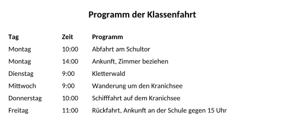
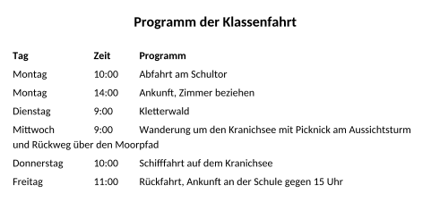
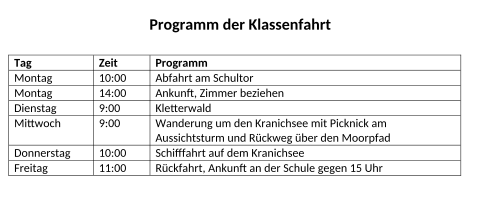

image: teaser.webp
image_alt: "Das Programm der Klassenfahrt: Tag, Zeit und Programm in drei Spalten, mit Tabs gesetzt"
kind: labor
duration: 1 Stunde (45 Minuten)
curriculum: "Sek I: Standardsoftware (Umgang mit Textverarbeitungssoftware); Medienbildung: Produzieren (Herstellung von Medienprodukten)"
topics: [standardsoftware]
language: Word / LibreOffice / Nextcloud Office
languages: [word, libreoffice, nextcloud]
requires: [lists-and-tabs]
reference: []

# Tabellen

Das Programm der Klassenfahrt steht in drei Spalten: Tag, Zeit, Programm.
Gebaut ist es mit zwei Tabstopps, so wie im letzten Blatt die Preise:

_task(laenger)

<!-- after: laenger -->

Ein Tab springt nur in der Zeile zum nächsten Tabstopp. Bricht der Text um,
fängt die neue Zeile wieder am linken Rand an: Die Spalten gelten nur für die
erste Zeile.
<!-- /after -->

## Eine Tabelle

Hol dir das Programm:

<a class='document-starter btn btn-primary' href='/word-tables/04%20Programm.docx' download><i class='bi bi-file-earmark-word' aria-hidden='true'></i>Vorlage herunterladen:04 Programm.docx</a>

In einer **Tabelle** hat jede Angabe ihre eigene **Zelle**. Wird ein Eintrag
länger, wächst seine Zeile nach unten, und alles bleibt in seiner Spalte. Aus
Text mit Tabs macht das Programm eine Tabelle auf einmal: Jeder Tab wird eine
neue Spalte, jeder Absatz eine Zeile.

<!-- language: word -->
In Word markierst du die sieben Zeilen und wählst im Register *Einfügen*
<i class='bi bi-chevron-right' aria-hidden='true'></i> *Tabelle* <i class='bi bi-chevron-right' aria-hidden='true'></i> *Text in Tabelle umwandeln*, getrennt durch *Tabstopps*.
<!-- /language -->
<!-- language: libreoffice -->
In LibreOffice markierst du die sieben Zeilen und wählst *Tabelle* <i class='bi bi-chevron-right' aria-hidden='true'></i>
*Umwandeln* <i class='bi bi-chevron-right' aria-hidden='true'></i> *Text in Tabelle*, Text trennen bei *Tabulatoren*.
<!-- /language -->
<!-- language: nextcloud -->
In Nextcloud Office markierst du die sieben Zeilen und wählst *Tabelle*
<i class='bi bi-chevron-right' aria-hidden='true'></i> *Umwandeln* <i class='bi bi-chevron-right' aria-hidden='true'></i> *Text in Tabelle*, Text trennen bei *Tabulatoren*.
<!-- /language -->

_task(spalten)

**Jetzt bist du dran:** Mach aus dem Programm eine Tabelle mit drei Spalten.
Mach den Mittwoch dann länger, mit dem Picknick am Aussichtsturm, und sieh
nach, was mit dem Donnerstag passiert.

## Die Kopfzeile

Die erste Zeile mit Tag, Zeit und Programm ist die **Kopfzeile** der Tabelle.
Wird eine Tabelle länger als eine Seite, soll sie auf jeder Seite oben stehen.

<!-- language: word -->
In Word stellst du den Cursor in die erste Zeile und klickst im Register
*Tabellenlayout* auf *Überschriften wiederholen*.
<!-- /language -->
<!-- language: libreoffice -->
In LibreOffice stellst du den Cursor in die Tabelle und wählst *Tabelle* <i class='bi bi-chevron-right' aria-hidden='true'></i>
*Eigenschaften* <i class='bi bi-chevron-right' aria-hidden='true'></i> *Textfluss*, Haken bei *Überschrift wiederholen*.
<!-- /language -->
<!-- language: nextcloud -->
In Nextcloud Office stellst du den Cursor in die Tabelle und wählst *Tabelle*
<i class='bi bi-chevron-right' aria-hidden='true'></i> *Eigenschaften* <i class='bi bi-chevron-right' aria-hidden='true'></i> *Textfluss*, Haken bei *Überschrift wiederholen*.
<!-- /language -->

## Prüfen

_task(programm)

<!-- after: programm -->

<strong>Ausprobieren:</strong> Füge unter dem Dienstag eine Zeile ein (Rechtsklick in die Zeile, <em>Einfügen</em>) und trag einen Abend am Lagerfeuer ein. Achte darauf, was mit den Zeilen darunter passiert.

<!-- /after -->
