<div class='meta'>
image: working-with-files.webp
kind: grundlagen
reference: [workspace, terminal]
</div>

<div
    class="autotoc-secondary-trigger"
    data-title="Auf dieser Seite"
    data-levels="h2,h3">
</div>

# Dateien und Verzeichnisse

<p class='abstract'>
In diesem Kapitel lernst du, wie du mit Dateien und Verzeichnissen im Terminal arbeiten kannst. Wir werden einige der wichtigsten Befehle kennenlernen, die wir verwenden können, um Dateien und Verzeichnisse zu erstellen, zu löschen, zu kopieren, zu verschieben und zu bearbeiten. Wir werden auch lernen, wie wir den Inhalt von Dateien anzeigen und analysieren können.
</p>

## Das Terminal öffnen

_include(workspace#terminal-oeffnen)

Alle Befehle im Terminal einzugeben anstatt durch Mausklick, wird auch »Arbeiten auf der Kommandozeile« genannt.
Im Terminal siehst du nun die Eingabeaufforderung, auch Prompt genannt, der dir u.a. anzeigt, in welchem Verzeichnis du dich befindest. Der Prompt sieht in etwa so aus:

```bash
student@workspace:~$
```

Lass dich von dem Prompt nicht verwirren. Der Teil vor dem `@` ist dein Benutzername: Auf den Bildern hier steht dort `student`, bei dir steht dort dein eigener Name. Der Teil `workspace` nach dem `@` ist der Name deines Computers, und der Teil nach dem `:` ist das aktuelle Verzeichnis. In diesem Fall ist das aktuelle Verzeichnis `~`, welches die Abkürzung für dein Home-Verzeichnis ist. Das `$` am Ende des Prompts zeigt an, dass du als normaler Benutzer angemeldet bist. Wenn du als Administrator angemeldet wärst, würde das `$` durch ein `#` ersetzt.

Gib folgenden Befehl ein und drücke die Eingabetaste:

```bash
echo "Hello, World!"
```
Wenn du die Ausgabe `Hello, World!` siehst, hast du alles richtig gemacht. Herzlichen Glückwunsch!

<!-- tutorial-screenshot
# Terminal öffnen: Handbuch »Workspace«, eingebunden oben
hide-left-sidebar
terminal-open
terminal-run: echo "Hello, World!"
terminal-wait-for-prompt
crop-terminal-lines: auto
-->

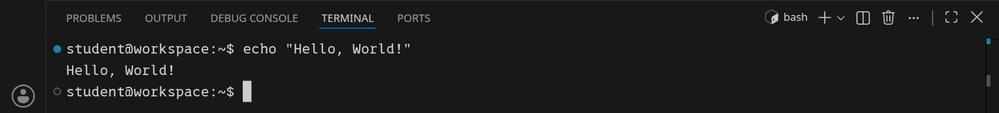

Jetzt können wir anfangen, mit Dateien und Verzeichnissen zu arbeiten.

## Beispieldateien herunterladen

Gib folgenden Befehl ein, um eine Datei aus dem Internet herunterzuladen, die ein paar Beispieldateien enthält:

```bash
wget https://github.com/specht/workspace-files/raw/main/working-with-files.tar.gz
```
Die Ausgabe sollte in etwa so aussehen:

<!-- tutorial-screenshot
terminal-maximize
terminal-run: clear
terminal-run: wget https://github.com/specht/workspace-files/raw/main/working-with-files.tar.gz
terminal-wait-for-prompt
wait-for-file: working-with-files.tar.gz
crop-terminal-lines: auto
-->

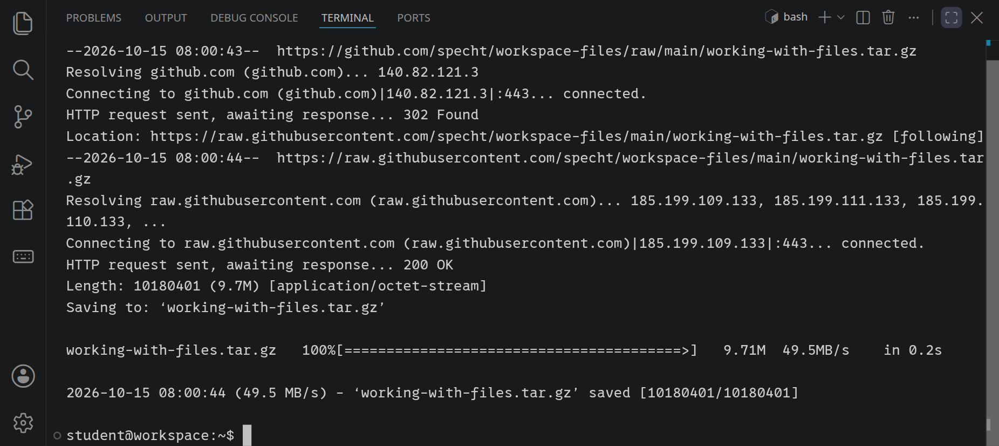

<div class='hint'>
Lass dich nicht davon stören, dass die Ausgabe so umfangreich ist. Der Grund dafür ist, dass der Webserver die
Anfrage auf eine andere URL umleitet (»302 Found«) und <code>wget</code> dieser Umleitung folgt. Die eigentliche Datei wird
dann heruntergeladen (»200 OK«) und die Ausgabe von <code>wget</code> zeigt dir den Fortschritt an.
</div>

Das Programm `wget` können wir dazu verwenden, um Dateien aus dem Internet herunterzuladen.
Die Datei wird standardmäßig im aktuellen Verzeichnis gespeichert. Schau nach, ob die Datei
angekommen ist, indem du den Befehl `ls` (kurz für »list«) eingibst:

<!-- tutorial-screenshot
terminal-run: clear
terminal-run: ls
terminal-wait-for-prompt
crop-terminal-lines: auto
-->

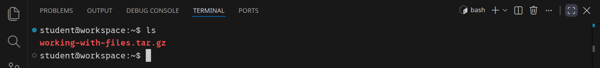

Viele Befehle auf der Kommandozeile haben Optionen, die stets hinter dem Befehlsnamen mit einem `-` beginnen.
Probiere hier den Befehl `ls -l` (für »long«), um dir mehr Details anzeigen zu lassen:

<!-- tutorial-screenshot
terminal-run: clear
terminal-run: ls -l
terminal-wait-for-prompt
crop-terminal-lines: auto
-->

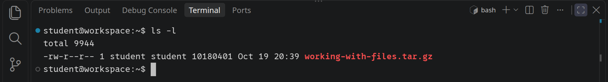

Du siehst nun u.a., wie groß die Datei ist. Nutze den Befehl `ls -lh` (für »long human-readable«),
um die Größe in einer besser lesbaren Form zu sehen:

<!-- tutorial-screenshot
terminal-run: clear
terminal-run: ls -lh
terminal-wait-for-prompt
crop-terminal-lines: auto
-->

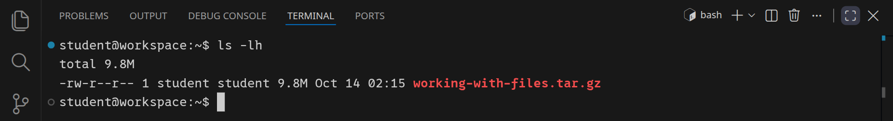

Die Datei ist also fast 10 MB groß.
Die Endung `.tar.gz` in unserem Beispiel zeigt an, dass es sich um ein komprimiertes Archiv handelt.
Wir können es mit dem Befehl `tar` entpacken:

```bash
tar xvf working-with-files.tar.gz
```

Die Optionen `xvf` stehen für `extract`, `verbose` und `file`. Das bedeutet, dass wir das
Archiv entpacken (`x` für »extract«), den Fortschritt anzeigen (`v` für »verbose«) und als
nächste Option den Dateinamen angeben (`f` für »file«).
Wenn du den Befehl ausführst, solltest du eine Meldung sehen, die dir anzeigt, welche Dateien entpackt wurden:

<!-- tutorial-screenshot
terminal-run: clear
terminal-run: tar xvf working-with-files.tar.gz
terminal-wait-for-prompt
crop-terminal-lines: auto
-->

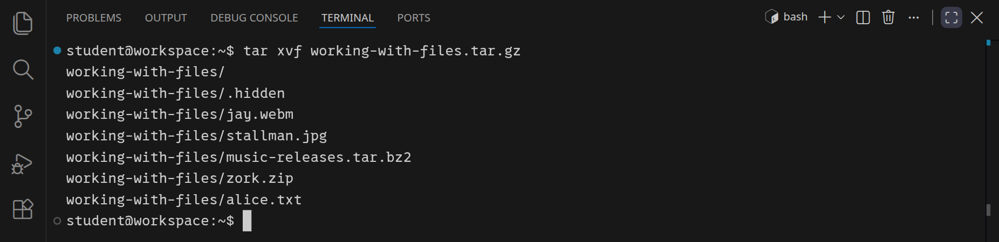

Gib noch einmal `ls -l` ein, um zu sehen, was sich nun in deinem Verzeichnis befindet:

<!-- tutorial-screenshot
terminal-run: clear
terminal-run: ls -l
terminal-wait-for-prompt
crop-terminal-lines: auto
-->

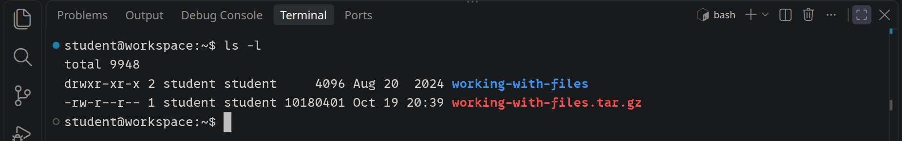

Du solltest jetzt zusätzlich zur heruntergeladenen Archivdatei ein Verzeichnis namens
`working-with-files` sehen. Du erkennst an dem `d` am Anfang der Zeile, dass es sich um ein
Verzeichnis handelt.

_task(entpackt)

<div class='hint'>
Um dein Terminal aufzuräumen, kannst du den Befehl <code>clear</code> verwenden oder einfach die Tastenkombination <kbd>Strg</kbd><kbd>L</kbd> drücken.
</div>

## Sich umsehen

<div class='hint books'>
In diesem Abschnitt lernst du die Befehle <code>pwd</code>, <code>cd</code>, <code>ls</code> und <code>file</code> kennen.
</div>

_uses(orientieren, cd, tasten)

### Wo bin ich?

Gib den Befehl `pwd` ein und drücke die Eingabetaste:

<!-- tutorial-screenshot
terminal-run: clear
terminal-run: pwd
terminal-wait-for-prompt
crop-terminal-lines: auto
-->

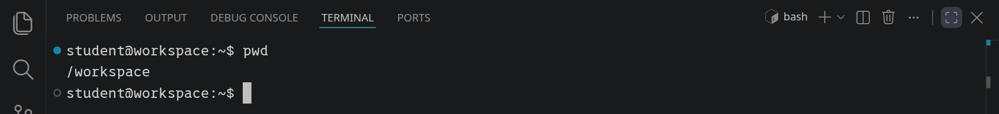

Der Befehl `pwd` steht für »print working directory« und zeigt dir das aktuelle Verzeichnis an, in dem du dich gerade befindest. Das aktuelle Verzeichnis wird auch im Prompt angezeigt – da im Workspace das Verzeichnis `/workspace` dein Home-Verzeichnis ist, wird es im Prompt mit `~` abgekürzt.

Wechsle nun in das entpackte Verzeichnis, indem du `cd working-with-files` eingibst und die Eingabetaste drückst. Du solltest nun im Verzeichnis `working-with-files` sein, was du leicht am Prompt erkennen kannst.

<!-- tutorial-screenshot
terminal-run: clear
terminal-run: cd working-with-files
terminal-wait-for-prompt
crop-terminal-lines: auto
-->

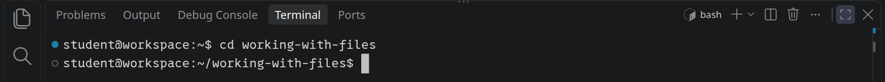

Wechsle wieder in das übergeordnete Verzeichnis, indem du `cd ..` eingibst und die Eingabetaste drückst. Du solltest nun wieder im Home-Verzeichnis sein.

<!-- tutorial-screenshot
terminal-run: cd ..
terminal-wait-for-prompt
crop-terminal-lines: auto
-->

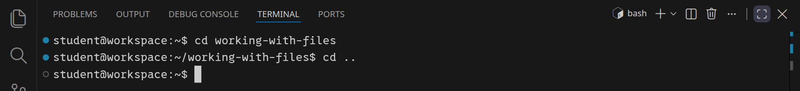

### Die Tab-Ergänzung

Ein nützliches Feature des Terminals ist die Tab-Ergänzung. Wenn du anfängst, einen Befehl oder einen Dateinamen einzugeben, kannst du die <kbd>Tab</kbd>-Taste drücken, um den Befehl oder den Dateinamen automatisch zu vervollständigen. Wenn es mehrere Möglichkeiten gibt, kannst du die <kbd>Tab</kbd>-Taste zweimal drücken, um eine Liste der verfügbaren Optionen zu sehen.

Wechsle wieder in das Verzeichnis, aber gib diesmal nur `cd w` ein und drücke die <kbd>Tab</kbd>-Taste. Das Terminal vervollständigt den Befehl automatisch, weil es nur eine mögliche Option für einen Verzeichniswechsel gibt, die mit `w` beginnt.

Lass dir anschließend die Inhalte des Verzeichnisses mit `ls -l` anzeigen:

<!-- tutorial-screenshot
terminal-run: clear
type: cd w
press: Tab
sleep: 0.5
press: Enter
terminal-run: ls -l
terminal-wait-for-prompt
crop-terminal-lines: auto
-->

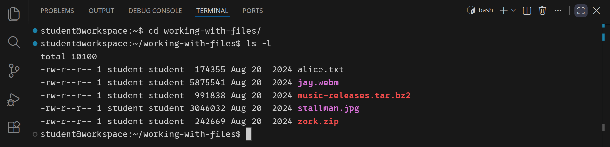

<div class='hint'>
Es gibt noch eine versteckte Datei in diesem Verzeichnis, die du dir mit dem Befehl <code>ls -la</code> (für »long all«) anzeigen lassen kannst. Versteckte Dateien beginnen unter Linux mit einem Punkt.
</div>

_task(versteckt)

### Was für Dateien sind das?

Gib nun den Befehl `file *` ein und drücke die Eingabetaste. Der Stern `*` ist ein Platzhalter, der für alle Dateien im aktuellen Verzeichnis steht. Der Befehl `file` zeigt den Dateityp einer Datei an und mit `file *` können wir also den Dateityp aller Dateien im aktuellen Verzeichnis anzeigen.

<!-- tutorial-screenshot
terminal-run: clear
terminal-run: file *
terminal-wait-for-prompt
crop-terminal-lines: auto
-->

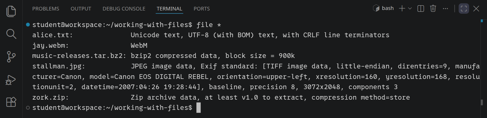

Oft ist der Dateityp einer Datei schon anhand der Dateiendung zu erkennen. Das Programm `file` kann jedoch auch den Dateityp von Dateien ohne Dateiendung bestimmen und gibt einige zusätzliche Informationen aus.

Wir sehen die folgenden Dateien:

<table class='table table-sm'>
<tr><td><code>alice.txt</code></td><td>eine normale Textdatei</td></tr>
<tr><td><code>jay.webm</code></td><td>eine Videodatei im WebM-Format</td></tr>
<tr><td><code>music-releases.tar.bz2</code></td><td>ein komprimiertes Archiv im Bzip2-Format</td></tr>
<tr><td><code>stallman.jpg</code></td><td>eine Bilddatei im JPEG-Format mit sehr vielen Metadaten</td></tr>
<tr><td><code>zork.zip</code></td><td>ein komprimiertes Archiv im ZIP-Format</td></tr>
</table>

In den folgenden Abschnitten wirst du weitere Befehle kennenlernen und anhand dieser Dateien ausprobieren können.

## Dateien anzeigen

<div class='hint books'>
In diesem Abschnitt lernst du die Befehle <code>cat</code>, <code>less</code> und <code>hd</code> kennen.
</div>

_uses(anzeigen)

### Text mit `cat` und `less`

Gib `cat alice.txt` ein und drücke die Eingabetaste. Der Befehl `cat` steht für »concatenate« und zeigt den Inhalt einer Datei an. Die Datei `alice.txt` enthält den Text des Buches »Alice im Wunderland« von Lewis Carroll. Der Text stammt von [Project Gutenberg](https://www.gutenberg.org/) und da der ganze Text im Terminal an dir vorbei rauscht, siehst du auch nur die letzten Zeilen, die auf die Quelle des Textes hinweisen:

<!-- tutorial-screenshot
terminal-run: clear
terminal-run: cat alice.txt
terminal-wait-for-prompt
crop-terminal-lines: 99
-->

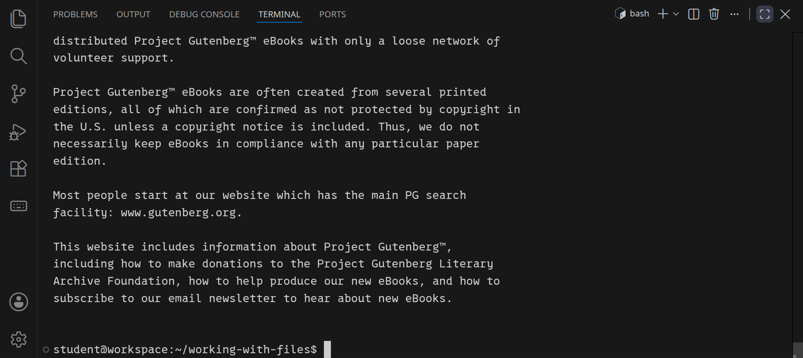

Um den Text Seite für Seite zu lesen und die Möglichkeit zum Scrollen zu bekommen, kannst du den Befehl `less` verwenden. Gib `less alice.txt` ein und drücke die Eingabetaste. Der Befehl `less` zeigt den Inhalt einer Datei an und ermöglicht es dir, durch den Text zu scrollen. Du kannst die Pfeiltasten <kbd>←</kbd><kbd>↑</kbd><kbd>→</kbd><kbd>↓</kbd> oder <kbd>Bild↑</kbd><kbd>Bild↓</kbd> sowie <kbd>Pos1</kbd> und <kbd>Ende</kbd> verwenden, um durch den Text zu navigieren. Drücke die Taste <kbd>Q</kbd> (für »quit«), um `less` zu beenden.

<div class='hint wink'>
Hast du daran gedacht, die <kbd>Tab</kbd>-Taste zu verwenden, um den Dateinamen zu vervollständigen?
</div>

### Andere Dateien in `less`

Wenn wir `less` mit den anderen Dateien verwenden, die keine Textdateien sind, sehen wir, dass `less` nicht für alle Dateitypen geeignet ist. Gib `less jay.webm` ein und drücke die Eingabetaste. Du siehst eine Warnung, dass `jay.webm` keine Textdatei ist und deshalb vermutlich nicht korrekt angezeigt werden kann:

<!-- tutorial-screenshot
terminal-run: clear
terminal-run: less jay.webm
wait-for-text: may be a binary file
crop-terminal-lines: auto
-->

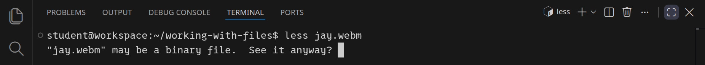

Wenn du hier mit `y` bestätigst, wird der Inhalt der Datei trotzdem angezeigt, aber es wird nicht lesbar sein:

<!-- tutorial-screenshot
press: y
sleep: 1
crop-terminal-lines: 99
-->

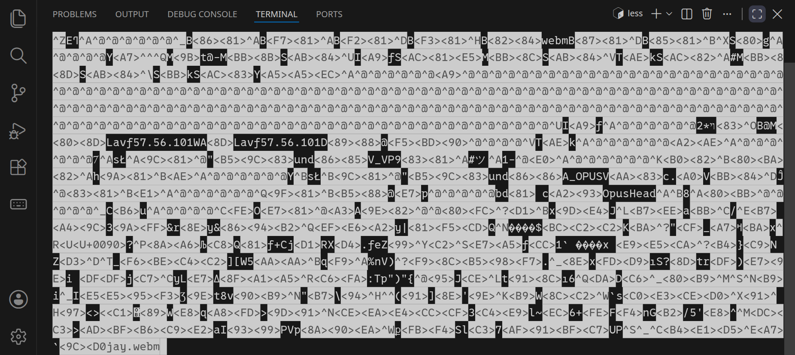

Drücke die Taste <kbd>Q</kbd>, um `less` zu beenden.

Mit `less stallman.jpg` siehst du, dass `less` bei Bildern zumindest ein paar Metadaten anzeigen kann:

<!-- tutorial-screenshot
press: q
terminal-wait-for-prompt
terminal-run: clear
terminal-run: less stallman.jpg
wait-for-text: (END)
crop-terminal-lines: auto
-->

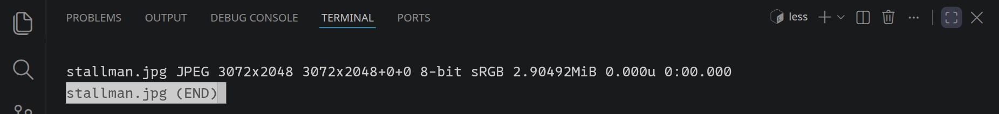

Wenn du `less` auf die Archivdateien anwendest, bekommst du eine Vorschau der Dateien, die sich im Archiv befinden:

<!-- tutorial-screenshot
press: q
terminal-wait-for-prompt
terminal-run: clear
terminal-run: less zork.zip
wait-for-text: zork-master/
sleep: 0.5
crop-terminal-lines: 99
-->

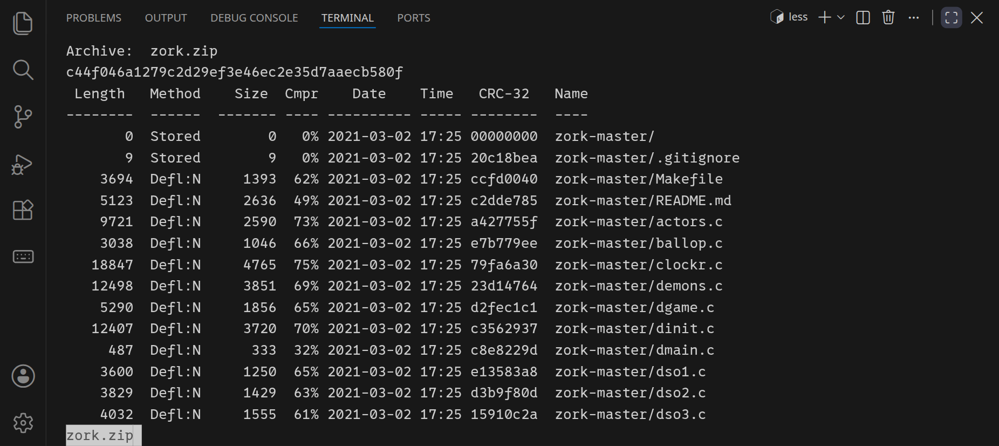

### Bytes mit `hd`

Um die einzelnen, tatsächlichen Bytes zu sehen, die in einer Datei gespeichert sind, kannst du den Befehl `hd` verwenden. Gib `hd alice.txt | less` ein und drücke die Eingabetaste. Der Befehl `hd` steht für »hexdump« und zeigt den Inhalt einer Datei in hexadezimaler Darstellung an. Du siehst die Bytes, die in der Datei gespeichert sind, und kannst so den Inhalt der Datei auf Byte-Ebene analysieren. Du kannst nun durch die Ausgabe von `hd` navigieren. Drücke die Taste <kbd>Q</kbd>, um das Programm zu beenden.

<div class='hint'>
Mit dem Zeichen <code>|</code> kann man mehrere Befehle in einer »Pipeline« miteinander verknüpfen. Die Ausgabe des ersten Befehls wird als Eingabe des zweiten Befehls verwendet. So können wir z. B. die Ausgabe von <code>hd</code> an die Eingabe von <code>less</code> weiterleiten, um die Ausgabe von <code>hd</code> seitenweise zu betrachten. Auf diese Weise lassen sich viele Befehle miteinander kombinieren.
</div>

<!-- tutorial-screenshot
press: q
terminal-wait-for-prompt
terminal-run: clear
terminal-run: hd alice.txt | less
wait-for-text: 00000000
sleep: 0.5
crop-terminal-lines: 99
-->

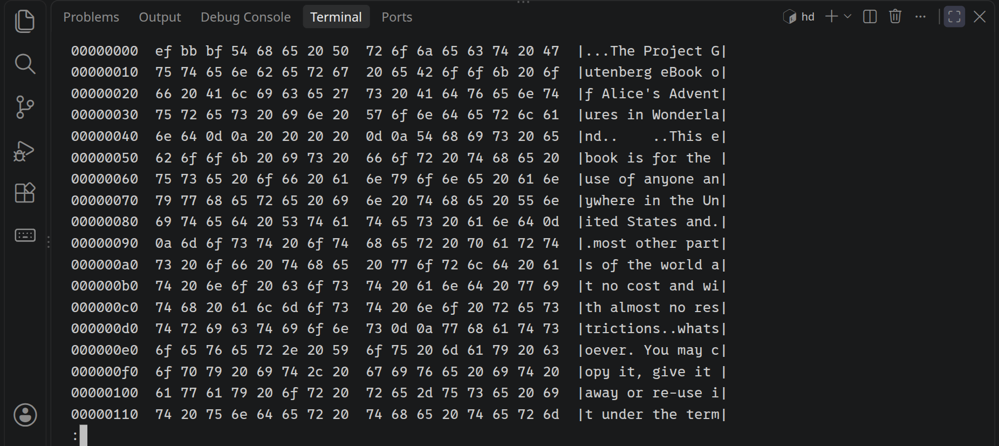

Im Hexdump siehst du immer 16 Bytes in einer Zeile. Die erste Spalte zeigt den Offset in der Datei an (hexadezimal), die zweite Spalte zeigt die hexadezimalen Werte der 16 Bytes an und die dritte Spalte zeigt die ASCII-Zeichen an, die den hexadezimalen Werten entsprechen. Wenn ein Byte nicht druckbar ist, wird ein Punkt angezeigt.

In der folgenden Tabelle siehst du, welche Werte welchem ASCII-Zeichen entsprechen:

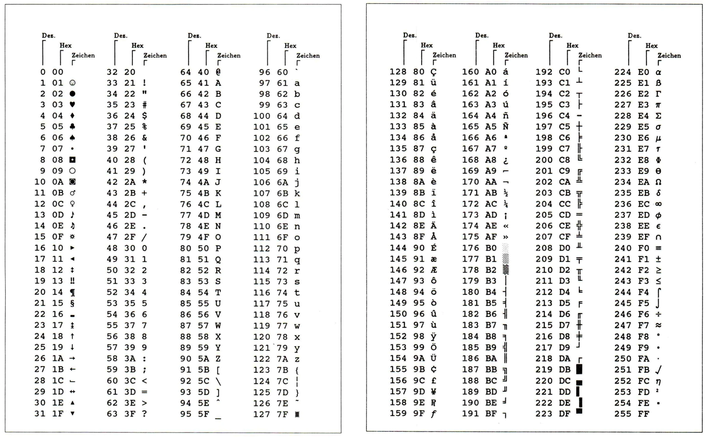

<div class='hint'>
Ignoriere die rechte Hälfte der Tabelle &ndash; die Werte von 128 bis 255 sind nicht standardisiert und können je nach Zeichensatz unterschiedlich sein (abgebildet ist eine ASCII-Tabelle für MS-DOS von 1990). Die linke Hälfte (0 bis 127) ist jedoch standardisiert und wird von allen modernen Systemen unterstützt, wobei die Zeichen von 0 bis 31 sowie 127 nicht druckbar sind.
</div>

Wenn du dir den Hexdump genau anschaust, findest du z. B. Leerzeichen (`20`) und Zeilenumbrüche (`0d` `0a`), auch CRLF genannt. Hieran erkennst du, dass es sich um eine Windows-Textdatei handelt. Linux-Textdateien verwenden nur ein LF (`0a`) als Zeilenumbruch (trotzdem kann Linux mit beiden Arten von Textdateien umgehen).

_task(zeilenende)

### Dateien in Visual Studio Code öffnen

Du kannst die Dateien natürlich auch in Visual Studio Code öffnen, indem du die linke Seitenleiste mit <kbd>Strg</kbd><kbd>B</kbd> einblendest und dann auf »Open Folder« klickst (oder einfach die Abkürzung <kbd>Strg</kbd><kbd>K</kbd>+<kbd>O</kbd> verwendest). Wähle das Verzeichnis `working-with-files` aus und klicke auf »OK«.

<!-- tutorial-screenshot
press: q
terminal-wait-for-prompt
terminal-run: clear
press: Control+K
press: Control+O
wait-for-input-value: /workspace/
type: working-with-files/
wait-for-input-value: /workspace/working-with-files/
sleep: 0.5
crop-bottom: 75%
-->

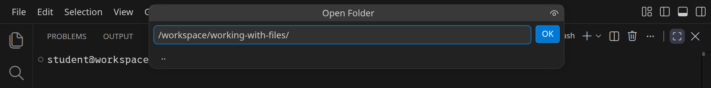

Links siehst du jetzt die Dateien und kannst sie (bis auf die Archivdateien) öffnen, um ihren Inhalt zu sehen.

<!-- tutorial-screenshot
press: Enter
wait-for-text: stallman.jpg
press: Control+P
type: jay.webm
sleep: 1
press: Enter
hide-bottom-panel
hook: seek-video 75
sleep: 1
-->

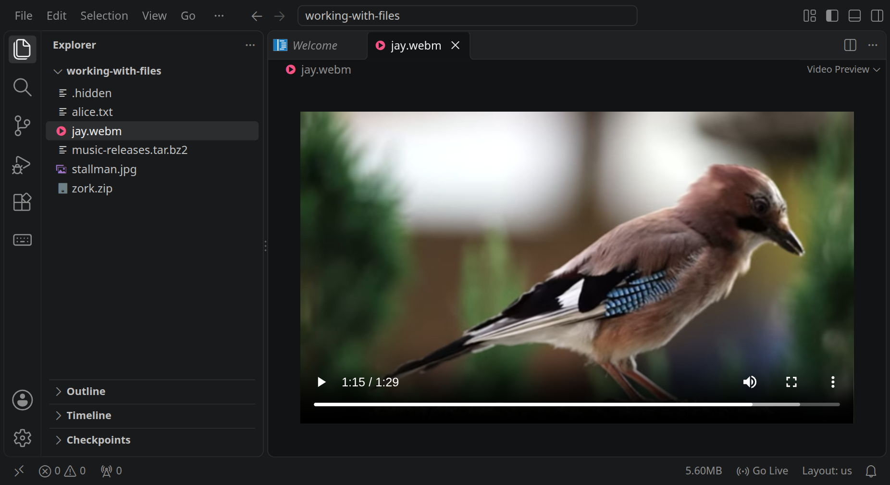

Schließe anschließend wieder alle Dateien und öffne das Terminal, um mit den nächsten Befehlen fortzufahren.

<div class='hint'>
Schließe die linke Seitenleiste und maximiere dein Terminal, um mehr Platz zu haben.
</div>

Nachdem wir uns nun einen Überblick verschafft und uns die Dateien angeschaut haben, werden wir im nächsten Abschnitt sehen, wie wir Dateien erstellen und bearbeiten können.

## Dateien erstellen und bearbeiten

<div class='hint books'>
In diesem Abschnitt lernst du die Befehle <code>touch</code>, <code>nano</code>, <code>vim</code> und <code>emacs</code> kennen.
</div>

_uses(editoren)

### Leere Dateien mit `touch`

Gib den Befehl `touch hello.txt` ein und drücke die Eingabetaste. Der Befehl `touch` erstellt eine leere Datei mit dem angegebenen Namen. Gib `ls -l` ein, um zu sehen, dass die Datei `hello.txt` erstellt wurde:

<!-- tutorial-screenshot
close-tab: jay.webm
hide-left-sidebar
terminal-open
terminal-maximize
terminal-run: clear
terminal-run: touch hello.txt
terminal-run: ls -l
terminal-wait-for-prompt
crop-terminal-lines: auto
-->

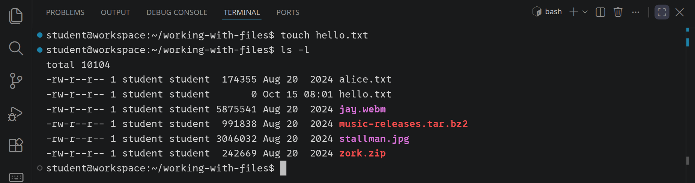

Da die Datei keinen Inhalt hat, beträgt ihre Größe erwartungsgemäß 0 Byte. Wenn du nach einer oder mehreren Minuten noch einmal `touch hello.txt` eingibst, siehst du, dass sich danach der Zeitstempel der Datei geändert hat:

<!-- tutorial-screenshot
sleep: 61
terminal-run: clear
terminal-run: touch hello.txt
terminal-run: ls -l
terminal-wait-for-prompt
crop-terminal-lines: auto
-->

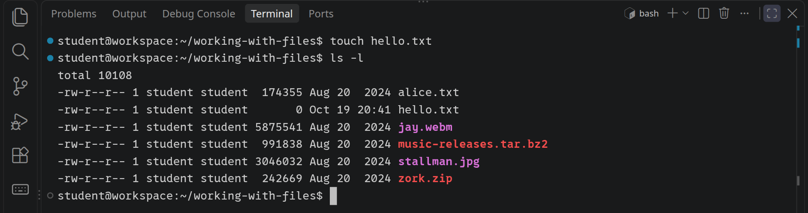

Der Befehl <code>touch</code> wird oft verwendet, um den Zeitstempel einer Datei zu aktualisieren, ohne den Inhalt zu verändern. Wenn die Datei nicht existiert, wird sie erstellt.

<div class='hint'>
Um einen vorherigen Befehl zu suchen, kannst du die Pfeiltasten <kbd>↑</kbd> und <kbd>↓</kbd> verwenden und anschließend die Eingabetaste drücken, um den Befehl erneut auszuführen. So vermeidest du wiederholte Eingaben.
</div>

Es gibt verschiedene Text-Editoren für Linux, mit denen du Dateien im Terminal bearbeiten kannst. Die gebräuchlichsten Editoren sind `nano`, `vim` und `emacs`. `nano` ist der einfachste Editor und wird oft für Anfänger empfohlen. `vim` und `emacs` sind mächtige Editoren, die viele Funktionen bieten, aber auch eine steile Lernkurve haben. Wir werden uns alle drei Editoren kurz ansehen.

### Dateien bearbeiten mit `nano`

Gib den Befehl `nano hello-nano.txt` ein, um eine neue Datei zu öffnen. Du kannst nun Text eingeben und relativ intuitiv im Text navigieren. Wenn du fertig bist, speichere deinen Text mit <kbd>Strg</kbd><kbd>O</kbd> (für »write out«) und bestätige mit der Eingabetaste. Beende `nano` mit <kbd>Strg</kbd><kbd>X</kbd> (für »exit«).

<!-- tutorial-screenshot
terminal-run: clear
terminal-run: nano hello-nano.txt
wait-for-text: GNU nano
type: Hello from nano
press: Control+O
wait-for-text: File Name to Write
press: Enter
wait-for-text: Wrote 1 line
crop-terminal-lines: 99
-->

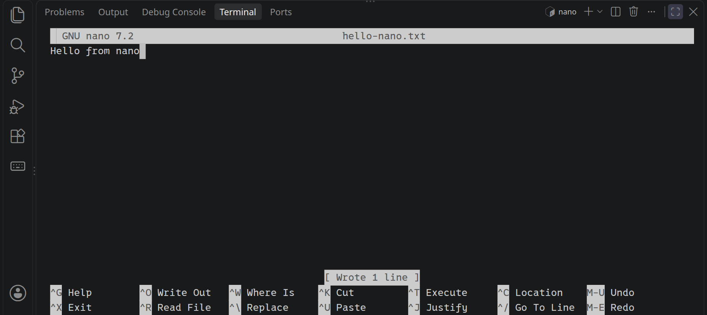

_task(nano)

### Dateien bearbeiten mit `vim`

Gib den Befehl `vim hello-vim.txt` ein, um eine neue Datei zu öffnen. `vim` hat verschiedene Modi, die du mit der Taste <kbd>Esc</kbd> wechseln kannst. Im Befehlsmodus kannst du Befehle eingeben, um Text zu bearbeiten. Im Einfügemodus kannst du Text eingeben. Um in den Einfügemodus zu wechseln, drücke <kbd>i</kbd> (für »insert«). Um den Eingabemodus zu verlassen und zum Befehlsmodus zurückzukehren, drücke <kbd>Esc</kbd>. Um `vim` zu beenden, wechsle in den Befehlsmodus und gib `:q` ein. Wenn du deine Änderungen speichern möchtest, gib `:w` ein. Wenn du `vim` beenden und deine Änderungen speichern möchtest, gib `:wq` ein.

<!-- tutorial-screenshot
press: Control+X
terminal-wait-for-prompt
terminal-run: clear
terminal-run: vim hello-vim.txt
wait-for-text: hello-vim.txt
press: i
type: Hello from vim
press: Escape
type: :w
press: Enter
wait-for-text: written
crop-terminal-lines: 99
-->

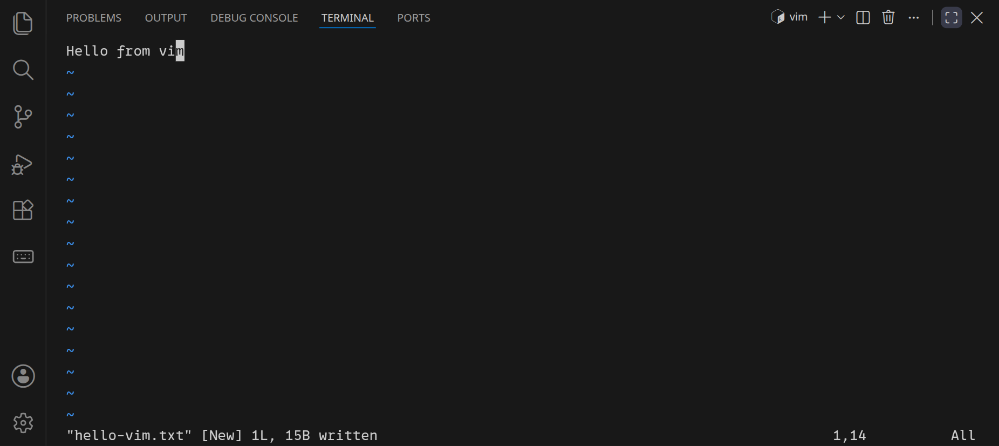

Für die oben stehende Eingabe musst du also folgende Tasten drücken:

1. <kbd>i</kbd> (für »insert«)
2. »Hello from vim« eingeben
3. <kbd>Esc</kbd> (um in den Befehlsmodus zu wechseln)
4. <kbd>:</kbd>, <kbd>w</kbd> und <kbd>Enter</kbd>, um die Datei zu speichern
5. <kbd>:</kbd>, <kbd>q</kbd> und <kbd>Enter</kbd>, um `vim` zu beenden

Falls du mehr über `vim` lernen und den Umgang mit diesem Editor trainieren möchtest, kannst du den Befehl `vimtutor` im Terminal eingeben, um ein interaktives Tutorial zu starten, für das du ca. 30 Minuten einplanen solltest:

<!-- tutorial-screenshot
type: :q
press: Enter
terminal-wait-for-prompt
terminal-run: clear
terminal-run: vimtutor
wait-for-text: Vim is a very powerful editor
sleep: 0.5
crop-terminal-lines: 99
-->

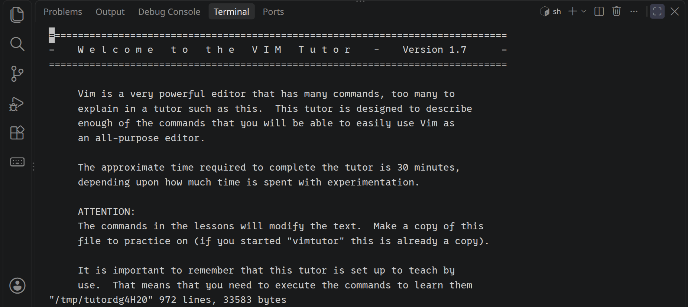

<div class='hint'>
<code>vimtutor</code> lässt sich, genau wie <code>vim</code> selbst, mit <kbd>:</kbd>, <kbd>q</kbd> und <kbd>Enter</kbd> beenden.
</div>

_task(vim)

### Dateien bearbeiten mit `emacs`

Gib den Befehl `emacs hello-emacs.txt` ein, um eine neue Datei zu öffnen. Im Gegensatz zu `vim` kannst du hier einfach anfangen, Text einzugeben. Wenn du fertig bist, speichere deine Änderungen mit <kbd>Strg</kbd><kbd>X</kbd> und dann <kbd>Strg</kbd><kbd>S</kbd> (für »save«). Um `emacs` zu beenden, drücke <kbd>Strg</kbd><kbd>X</kbd> und dann <kbd>Strg</kbd><kbd>C</kbd>.

<!-- tutorial-screenshot
type: :q
press: Enter
terminal-wait-for-prompt
terminal-run: clear
terminal-run: emacs hello-emacs.txt
wait-for-text: hello-emacs.txt
sleep: 1
type: Hello from emacs
press: Control+X
press: Control+S
wait-for-text: Wrote
crop-terminal-lines: 99
-->

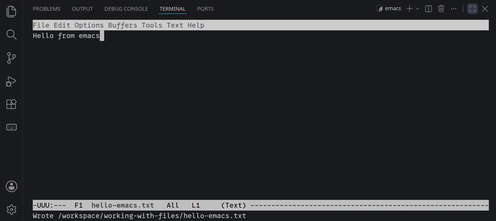

## Texte untersuchen

<div class='hint books'>
In diesem Abschnitt lernst du die Befehle <code>wc</code>, <code>grep</code>, <code>sort</code>, <code>uniq</code>, <code>head</code> und <code>tail</code> kennen.
</div>

_uses(grep, pipelines)

### Zählen mit `wc`

Gib den Befehl `wc alice.txt` ein und drücke die Eingabetaste. Der Befehl `wc` steht für »word count« und zeigt dir die Anzahl der Zeilen, Wörter und Bytes in einer Datei an:

<!-- tutorial-screenshot
press: Control+X
press: Control+C
terminal-wait-for-prompt
terminal-run: clear
terminal-run: wc alice.txt
terminal-wait-for-prompt
crop-terminal-lines: auto
-->

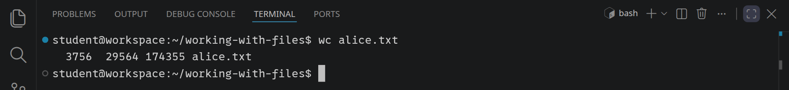

Die Datei `alice.txt` enthält also 3.756 Zeilen, 29.564 Wörter und 174.355 Bytes. Oft wird `wc` dazu verwendet, um die Anzahl der Zeilen in einer Datei zu zählen. Wenn du nur die Anzahl der Zeilen wissen möchtest, kannst du den Befehl `wc -l alice.txt` (`-l` für »lines«) verwenden:

<!-- tutorial-screenshot
terminal-run: clear
terminal-run: wc -l alice.txt
terminal-wait-for-prompt
crop-terminal-lines: auto
-->

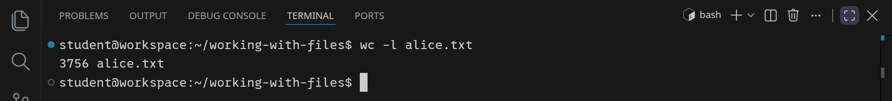

### Suchen mit `grep`

Verwende `grep`, um nach einem bestimmten Muster in einer Datei zu suchen. Gib `grep everybody alice.txt` ein und drücke die Eingabetaste. Der Befehl `grep` sucht nach dem Muster »everybody« in der Datei `alice.txt` und zeigt die Zeilen an, in denen das Muster gefunden wurde:

<!-- tutorial-screenshot
terminal-run: clear
terminal-run: grep everybody alice.txt
terminal-wait-for-prompt
crop-terminal-lines: auto
-->

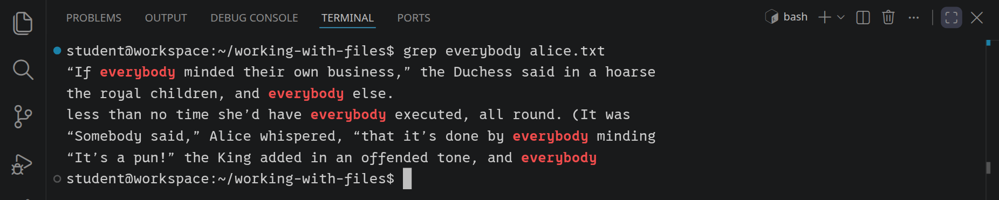

Mit der Option `-i` können wir `grep` anweisen, die Groß- und Kleinschreibung zu ignorieren. Gib `grep -i everybody alice.txt` ein und drücke die Eingabetaste:

<!-- tutorial-screenshot
terminal-run: clear
terminal-run: grep -i everybody alice.txt
terminal-wait-for-prompt
crop-terminal-lines: auto
-->

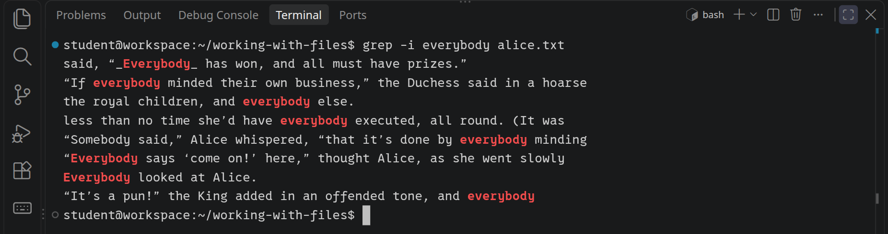

Wir haben nun ein paar weitere Stellen gefunden. Wenn du die Zeilennummern sehen möchtest, in denen das Muster gefunden wurde, kannst du die Option `-n` verwenden:

<!-- tutorial-screenshot
terminal-run: clear
terminal-run: grep -in everybody alice.txt
terminal-wait-for-prompt
crop-terminal-lines: auto
-->

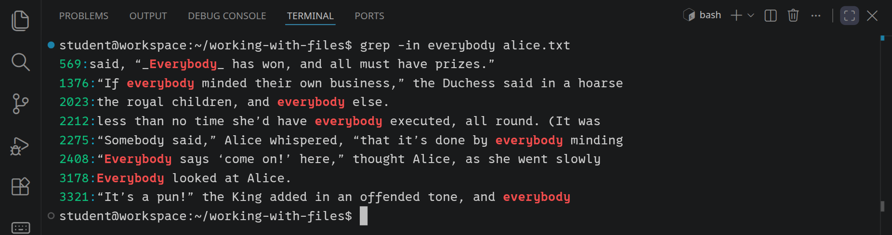

`grep` ist ein sehr mächtiges Programm mit einer Vielzahl von Optionen. Du kannst z. B. reguläre Ausdrücke verwenden, um nach komplexeren Mustern zu suchen. Gib `man grep` ein, um die manpage von `grep` zu lesen und mehr über die verschiedenen Optionen zu erfahren.

_task(alice-zeilen)

### Pipelines: alle Wörter eines Buchs

Wir wollen nun alle Wörter aus der Datei `alice.txt` extrahieren. Gib dazu den folgenden Befehl ein:

```bash
grep -o -E "[A-Za-z]+" alice.txt
```
Der reguläre Ausdruck `[A-Za-z]+` sucht nach Wörtern, die aus Groß- und Kleinbuchstaben bestehen. Du siehst, wie der gesamte Text Wort für Wort ausgegeben wird:

<!-- tutorial-screenshot
terminal-run: clear
terminal-run: grep -o -E "[A-Za-z]+" alice.txt
terminal-wait-for-prompt
crop-terminal-lines: 99
-->

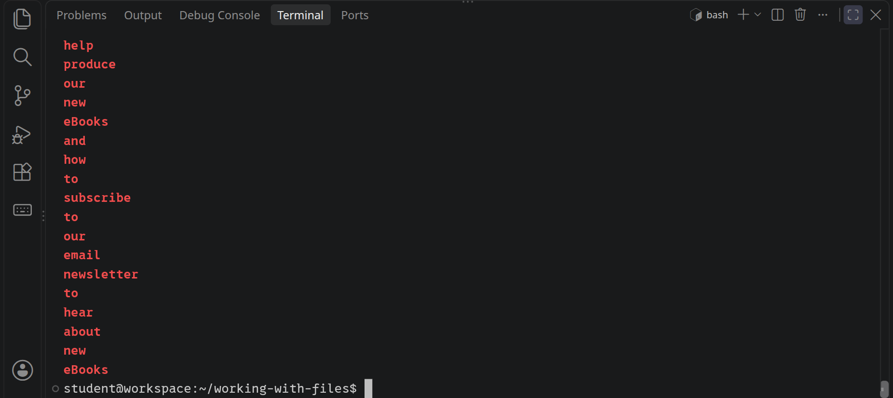

<div class='hint'>
Um eine lange Ausgabe seitenweise zu betrachten, kannst du an jeden Befehl einfach <code>| less</code> anhängen.
</div>

Nutze `sort`, um die Ausgabe zu sortieren:

```bash
grep -o -E "[A-Za-z]+" alice.txt | sort
```
Jetzt sind die Wörter alphabetisch sortiert:

<!-- tutorial-screenshot
terminal-run: clear
terminal-run: grep -o -E "[A-Za-z]+" alice.txt | sort
terminal-wait-for-prompt
crop-terminal-lines: 99
-->

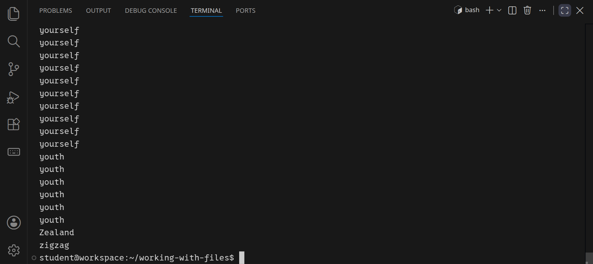

Um Duplikate zu entfernen, können wir `uniq` verwenden:

```bash
grep -o -E "[A-Za-z]+" alice.txt | sort | uniq
```

Dadurch wurden aufeinanderfolgende Duplikate entfernt und wir sehen nun eine alphabetisch sortierte Liste aller Wörter, die im Text vorkommen:

<!-- tutorial-screenshot
terminal-run: clear
terminal-run: grep -o -E "[A-Za-z]+" alice.txt | sort | uniq
terminal-wait-for-prompt
crop-terminal-lines: 99
-->

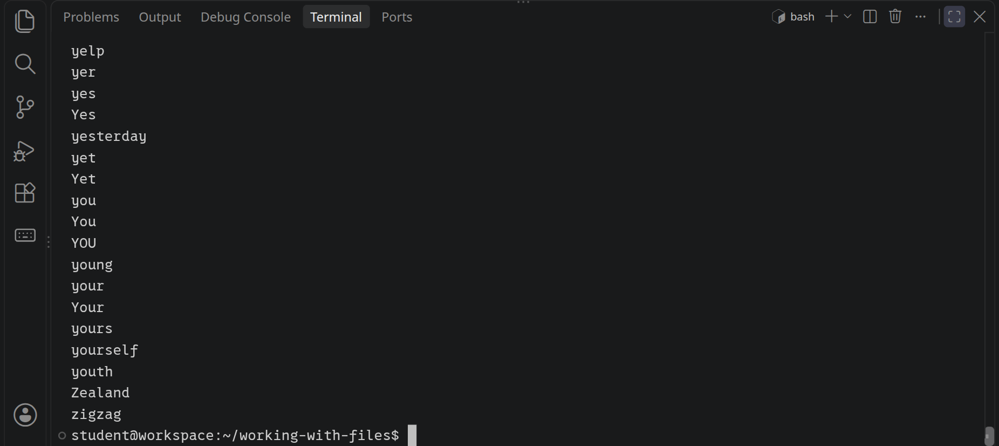

Allerdings gibt es hinsichtlich der Groß- und Kleinschreibung noch Duplikate (»you«, »You«, »YOU«). Um auch diese zu entfernen, können wir die Option `-i` von `uniq` verwenden (für »ignore case«):

```bash
grep -o -E "[A-Za-z]+" alice.txt | sort | uniq -i
```
Nun ist unsere Liste fertig:

<!-- tutorial-screenshot
terminal-run: clear
terminal-run: grep -o -E "[A-Za-z]+" alice.txt | sort | uniq -i
terminal-wait-for-prompt
crop-terminal-lines: 99
-->

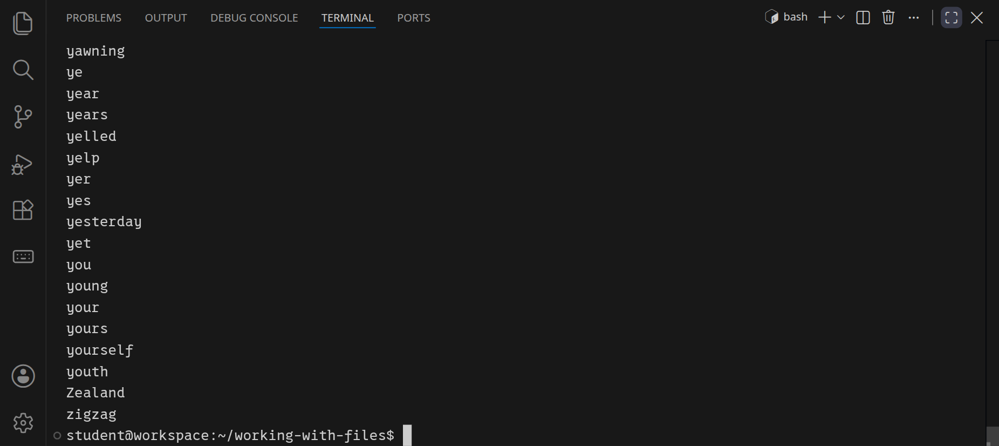

Wir können nun die Anzahl der Wörter in der Liste zählen:

```bash
grep -o -E "[A-Za-z]+" alice.txt | sort | uniq -i | wc -l
```
Die Ausgabe zeigt, dass es 3.002 verschiedene Wörter in der Datei `alice.txt` gibt.

<!-- tutorial-screenshot
terminal-run: clear
terminal-run: grep -o -E "[A-Za-z]+" alice.txt | sort | uniq -i | wc -l
terminal-wait-for-prompt
crop-terminal-lines: auto
-->

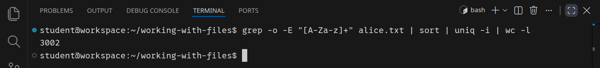

Wir können unser Ergebnis auch in einer Datei speichern, indem wir die Ausgabe der gesamten Pipeline in eine Datei umleiten:

```bash
grep -o -E "[A-Za-z]+" alice.txt | sort | uniq -i > words.txt
```

<!-- tutorial-screenshot
terminal-run: clear
terminal-run: grep -o -E "[A-Za-z]+" alice.txt | sort | uniq -i > words.txt
terminal-run: ls -l
terminal-wait-for-prompt
crop-terminal-lines: auto
-->

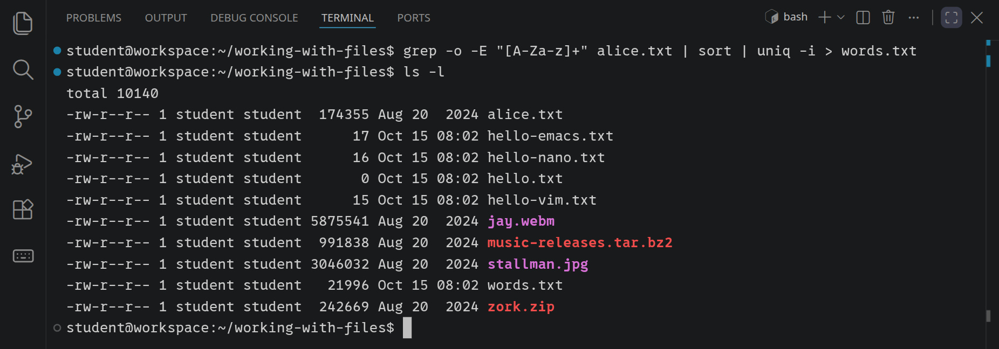

_task(woerter)

### Anfang und Ende: `head` und `tail`

Es gibt noch zwei weitere Befehle, die nützlich sind, wenn man nur den Anfang oder das Ende einer Datei oder einer Ausgabe sehen möchte. Nutze `head`, um die ersten 10 Zeilen einer Datei oder einer Ausgabe zu sehen:

```bash
head words.txt
```

<!-- tutorial-screenshot
terminal-run: clear
terminal-run: head words.txt
terminal-wait-for-prompt
crop-terminal-lines: auto
-->

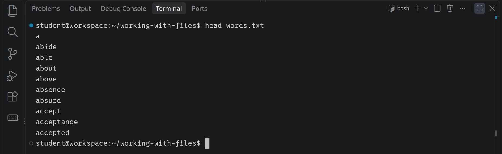

Analog dazu kannst du `tail` verwenden, um die letzten 10 Zeilen einer Datei oder einer Ausgabe zu sehen:

```bash
tail words.txt
```

<!-- tutorial-screenshot
terminal-run: clear
terminal-run: tail words.txt
terminal-wait-for-prompt
crop-terminal-lines: auto
-->

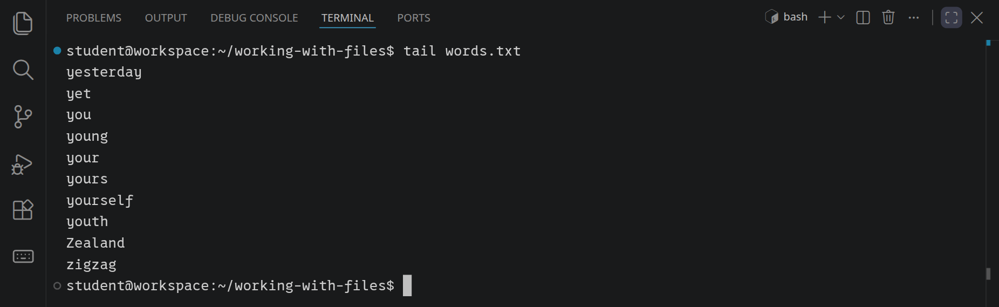

`tail` wird in Verbindung mit der Option `-f` (für »follow«) oft verwendet, um eine Datei in Echtzeit zu beobachten. Wenn du z. B. eine Logdatei überwachen möchtest, kannst du `tail -f logfile.log` verwenden, um die letzten Zeilen der Datei anzuzeigen und neue Zeilen anzuzeigen, sobald sie hinzugefügt werden.

## Archive entpacken und packen

<div class='hint books'>
In diesem Abschnitt lernst du die Befehle <code>tree</code>, <code>unzip</code>, <code>make</code>, <code>tar</code>, <code>gzip</code> und <code>bzip2</code> kennen.
</div>

_uses(archive)

### Ein ZIP-Archiv: das Spiel Zork

Gib den Befehl `tree` ein, um eine Baumstruktur des aktuellen Verzeichnisses anzuzeigen.

<!-- tutorial-screenshot
terminal-run: clear
terminal-run: tree
terminal-wait-for-prompt
crop-terminal-lines: auto
-->

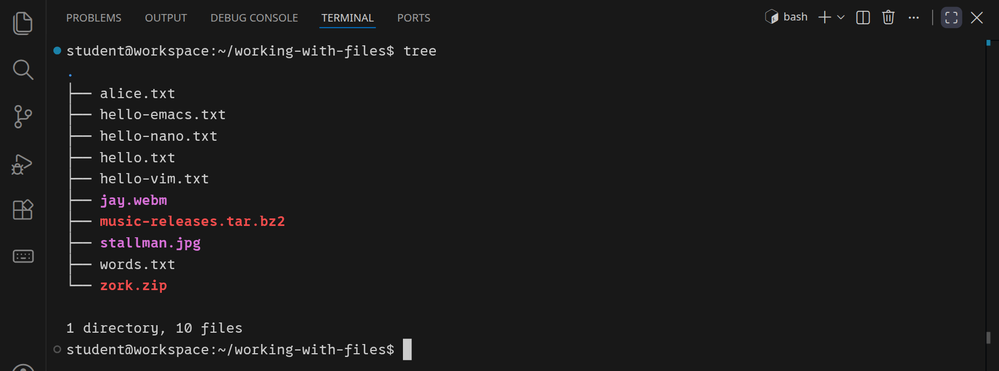

Im Moment unterscheidet sich die Ausgabe von `tree` noch nicht sehr von der Ausgabe von `ls`. Das liegt daran, dass wir uns in einem flachen Verzeichnis ohne Unterverzeichnisse befinden. Wenn wir uns in einem tiefer verschachtelten Verzeichnis befinden, wird die Ausgabe von `tree` nützlicher.

Nutze `unzip`, um das Archiv `zork.zip` zu entpacken:

```bash
unzip zork.zip
```

`unzip` entpackt alle Dateien aus dem Archiv `zork.zip` in das aktuelle Verzeichnis.

<!-- tutorial-screenshot
terminal-run: clear
terminal-run: unzip zork.zip
terminal-wait-for-prompt
crop-terminal-lines: 99
-->

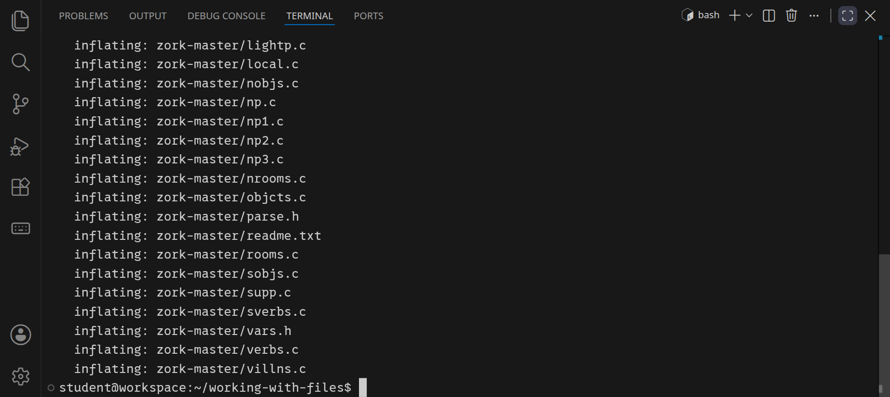

Wenn du nun wieder `tree` eingibst und nach oben scrollst, siehst du, dass das Verzeichnis `zork-master` mit einigen Dateien hinzugefügt wurde:

<!-- tutorial-screenshot
terminal-run: clear
terminal-run: tree
terminal-wait-for-prompt
crop-terminal-lines: 99
-->

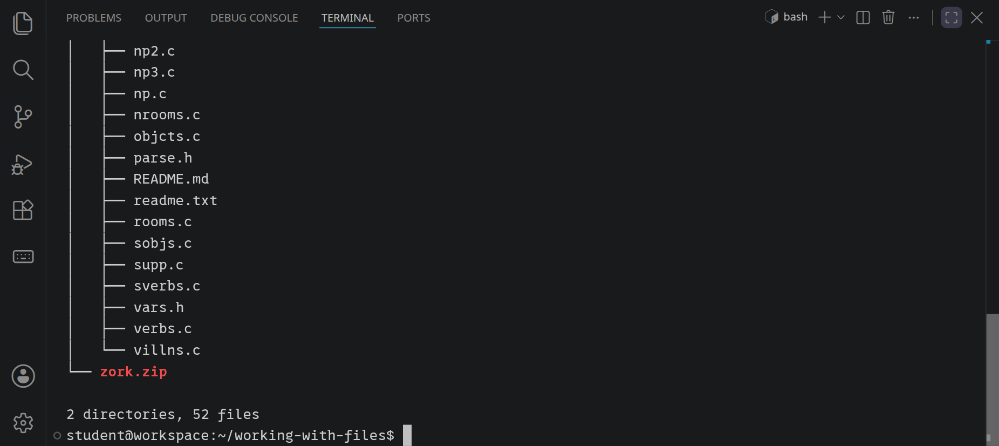

Wechsle in das Verzeichnis `zork-master` und gib `ls` ein, um zu sehen, was sich darin befindet:

```bash
cd zork-master
ls
```

<!-- tutorial-screenshot
terminal-run: clear
terminal-run: cd zork-master
terminal-run: ls
terminal-wait-for-prompt
crop-terminal-lines: auto
-->

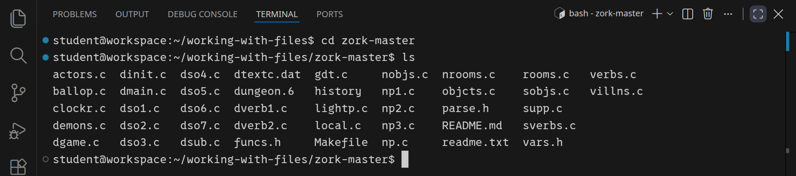

Lass dir den Inhalt der Datei `readme.txt` anzeigen:

```bash
cat readme.txt
```

<!-- tutorial-screenshot
terminal-run: clear
terminal-run: cat readme.txt
terminal-wait-for-prompt
crop-terminal-lines: auto
-->

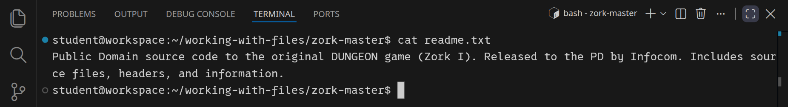

Es handelt sich also um ein Spiel. Da es in der Programmiersprache [C](/c) geschrieben ist und es ein `Makefile` gibt, können wir es leicht kompilieren, um ein ausführbares Programm zu erhalten.

```bash
make
```

Ein paar Sekunden und wenige Warnungen später haben wir ein ausführbares Programm namens `zork`:

<!-- tutorial-screenshot
terminal-run: clear
terminal-run: make
terminal-wait-for-prompt
wait-for-file: working-with-files/zork-master/zork
terminal-run: clear
terminal-run: ls
terminal-wait-for-prompt
crop-terminal-lines: auto
-->

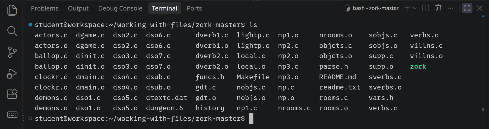

Du kannst das Spiel starten, indem du `./zork` eingibst:

<!-- tutorial-screenshot
terminal-run: clear
terminal-run: ./zork
wait-for-text: Welcome to
sleep: 1
crop-terminal-lines: auto
-->

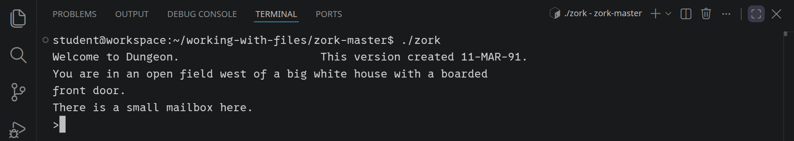

<div class='hint'>
Anders als unter Windows kannst du hier nicht einfach <code>zork</code> eingeben, um das Spiel zu starten, da das aktuelle Verzeichnis nicht im Suchpfad enthalten ist. Du musst also explizit angeben, dass du die Datei <code>zork</code> im aktuellen Verzeichnis (welches mit <code>.</code> bezeichnet wird) ausführen möchtest.
</div>

Falls du [Zork](https://de.wikipedia.org/wiki/Zork) beenden möchtest, bevor du das Spiel durchgespielt hast, kannst du dies durch die Eingabe von `quit` erreichen.

_task(zork)

### Ein tar-Archiv: eine Musiksammlung

Verlasse nun wieder das Verzeichnis `zork-master`, indem du `cd ..` eingibst. Wir werden nun das Archiv `music-releases.tar.bz2` entpacken:

```bash
tar xvf music-releases.tar.bz2
```

Nach dem Entpacken siehst du, dass ein neues Verzeichnis `music-releases` hinzugefügt wurde. Die Ausgabe von `tree music-releases` zeigt dir die Baumstruktur des Verzeichnisses:

<!-- tutorial-screenshot
terminal-run: quit
sleep: 1
terminal-run: y
terminal-wait-for-prompt
terminal-run: cd ..
terminal-run: tar xvf music-releases.tar.bz2
terminal-wait-for-prompt
terminal-run: clear
terminal-run: tree music-releases
terminal-wait-for-prompt
crop-terminal-lines: 99
-->

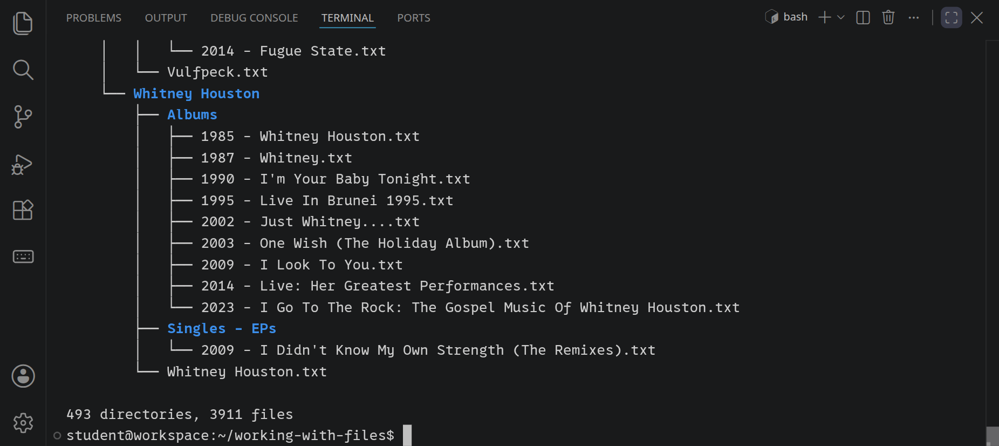

Es handelt sich um ein Verzeichnis mit mehreren Unterverzeichnissen, in dem sich Alben und Singles / EPs verschiedener Künstlerinnen und Künstler bzw. Bands, nach Land und Jahr sortiert, befinden.

Wechsle in das Verzeichnis und lass dir den Inhalt anzeigen:

```bash
cd music-releases
ls -l
```

<!-- tutorial-screenshot
terminal-run: clear
terminal-run: cd music-releases
terminal-run: ls -l
terminal-wait-for-prompt
crop-terminal-lines: auto
-->

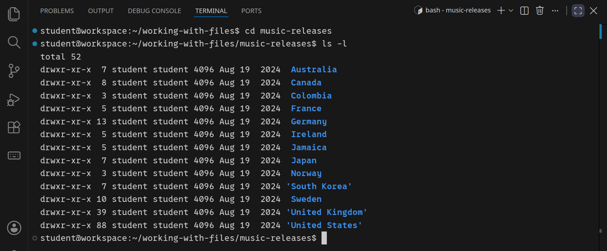

Dir fällt sicherlich auf, dass einige Verzeichnisnamen in Anführungszeichen stehen. Das liegt daran, dass sie Leerzeichen enthalten. Wenn du einen Datei- oder Verzeichnisnamen als Argument an einen Befehl übergibst und der Name Leerzeichen enthält, musst du den Namen in Anführungszeichen setzen, damit der Befehl den Namen als ein Argument erkennt.

Wechsle in das Verzeichnis `Japan/Radwimps` (verwende wie immer die <kbd>Tab</kbd>-Taste) und lass dir den Inhalt anzeigen:

```bash
cd Japan/Radwimps/
ls -l
```

<!-- tutorial-screenshot
terminal-run: clear
terminal-run: cd Japan/Radwimps/
terminal-run: ls -l
terminal-wait-for-prompt
crop-terminal-lines: auto
-->

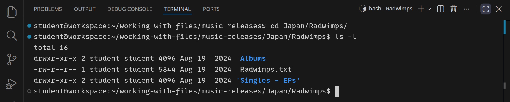

Eine kurze Information zur Geschichte der Band findest du in der Datei `Radwimps.txt`, die du dir mit `less` anzeigen lassen kannst:

```bash
less Radwimps.txt
```

<!-- tutorial-screenshot
terminal-run: clear
terminal-run: less Radwimps.txt
wait-for-text: RADWIMPS
sleep: 0.5
crop-terminal-lines: 99
-->


Schau auch in ein paar Alben rein, um ein Gefühl für die Tab-Ergänzung zu bekommen:

```bash
less Albums/2016\ -\ 君の名は。.txt
```

<!-- tutorial-screenshot
press: q
terminal-wait-for-prompt
terminal-run: clear
terminal-run: less Albums/2016\ -\ 君の名は。.txt
sleep: 1
crop-terminal-lines: 99
-->


<div class='hint'>
Lass dir nun das Album »Die Bestie in Menschengestalt« der Band »Die Ärzte« anzeigen. Wenn du das geschafft hast, hast du die Navigation im Dateisystem und die Tab-Ergänzung gemeistert!
</div>

_task(bestie)

<!-- tutorial-screenshot
press: q
terminal-wait-for-prompt
terminal-run: clear
terminal-run: cd ../../Germany/Die\ Ärzte/Albums/
terminal-run: less 1993\ -\ Die\ Bestie\ In\ Menschengestalt.txt
sleep: 1
crop-terminal-lines: 99
-->


### Komprimieren mit `gzip` und `bzip2`

Gehe nun wieder ins Verzeichnis `working-with-files` zurück und lass dir die Größe der Datei `alice.txt` anzeigen:

```bash
cd ~/working-with-files
ls -l alice.txt
```

<!-- tutorial-screenshot
press: q
terminal-wait-for-prompt
terminal-run: clear
terminal-run: cd ~/working-with-files
terminal-run: ls -l alice.txt
terminal-wait-for-prompt
crop-terminal-lines: auto
-->


Die Datei ist 174.355 Bytes groß. Wir können sie komprimieren, um Speicherplatz zu sparen. Dazu verwenden wir `gzip`:

```bash
gzip alice.txt
ls -l alice.txt.gz
```

`gzip` hat die Datei `alice.txt` komprimiert und in die Datei `alice.txt.gz` umgewandelt. Die Datei ist jetzt nur noch 61.204 Bytes groß und belegt damit nur noch 35% des ursprünglichen Speicherplatzes:

<!-- tutorial-screenshot
terminal-run: clear
terminal-run: gzip alice.txt
terminal-run: ls -l alice.txt.gz
terminal-wait-for-prompt
crop-terminal-lines: auto
-->


Um die Datei wieder zu entpacken, verwenden wir `gzip -d`:

```bash
gzip -d alice.txt.gz
```

Die Option `-d` steht für »decompress« und entpackt die Datei `alice.txt.gz` wieder in die Datei `alice.txt`. Wenn du dir die Größe der Datei `alice.txt` ansiehst, wirst du feststellen, dass sie wieder 174.355 Bytes groß ist:

<!-- tutorial-screenshot
terminal-run: clear
terminal-run: gzip -d alice.txt.gz
terminal-run: ls -l alice.txt
terminal-wait-for-prompt
crop-terminal-lines: auto
-->


Wir können die Datei auch mit `bzip2` komprimieren:

```bash
bzip2 alice.txt
ls -l alice.txt.bz2
```

<!-- tutorial-screenshot
terminal-run: clear
terminal-run: bzip2 alice.txt
terminal-run: ls -l alice.txt.bz2
terminal-wait-for-prompt
crop-terminal-lines: auto
-->


Wie du siehst, hat `bzip2` eine noch kleinere Datei erzeugt, die nur 48.925 Bytes groß ist und somit nur noch 28% des ursprünglichen Speicherplatzes belegt. Um die Datei wieder zu entpacken, verwenden wir `bzip2 -d`:

```bash
bzip2 -d alice.txt.bz2
ls -l alice.txt
```

<!-- tutorial-screenshot
terminal-run: clear
terminal-run: bzip2 -d alice.txt.bz2
terminal-run: ls -l alice.txt
terminal-wait-for-prompt
crop-terminal-lines: auto
-->


Die Datei ist wieder 174.355 Bytes groß.

## Verzeichnisse untersuchen

<div class='hint books'>
In diesem Abschnitt lernst du den Befehl <code>du</code> kennen und durchsuchst mit <code>grep</code> ganze Verzeichnisse.
</div>

_uses(du, grep)

### Wie viel Platz? `du`

Gib den Befehl `du -h` ein und drücke die Eingabetaste. Der Befehl `du` steht für »disk usage« und zeigt dir die Größe eines Verzeichnisses an. Die Option `-h` steht für »human-readable« und zeigt die Größe in einer besser lesbaren Form an:

<!-- tutorial-screenshot
terminal-run: clear
terminal-run: du -h
terminal-wait-for-prompt
crop-terminal-lines: 99
-->


An der letzten Zeile erkennst du, dass das ganze Verzeichnis mit allen Unterverzeichnissen insgesamt 30 MB groß ist. Falls dich interessiert, wie viel Speicherplatz jedes einzelne Unterverzeichnis belegt, kannst du die Option `-d` (für »depth«) verwenden, um die Tiefe der Analyse anzugeben. Gib `du -h -d 2` ein, um die Größen der Unterverzeichnisse bis zu einer Tiefe von 2 anzuzeigen:

<!-- tutorial-screenshot
terminal-run: clear
terminal-run: du -h -d 2
terminal-wait-for-prompt
crop-terminal-lines: auto
-->


Man sieht hier sehr gut, dass die Unterverzeichnisse `United States` und `United Kingdom` am meisten Speicherplatz belegen.

### In allen Dateien suchen: `grep -r`

Wir können den Befehl `grep`, den wir weiter oben schon kennen gelernt haben, auch auf Verzeichnisse anwenden. Wechsle nun wieder ins Verzeichnis `music-releases`, und verwende den Befehl `grep`, um alle Dateien zu finden, die das Wort »welcome« enthalten:

```bash
cd music-releases
grep -ri welcome .
```

Dabei stehen die Optionen `-r` für »recursive« (rekursiv) und `-i` für »ignore case« (Groß- und Kleinschreibung ignorieren). Der Punkt `.` steht für das aktuelle Verzeichnis. Es bedeutet also: untersuche alle Dateien im aktuellen Verzeichnis und allen Unterverzeichnissen. Wenn du den Befehl ausführst, siehst du alle Dateien, die das Wort »welcome« enthalten:

<!-- tutorial-screenshot
terminal-run: clear
terminal-run: cd music-releases
terminal-run: grep -ri welcome .
terminal-wait-for-prompt
crop-terminal-lines: 99
-->


_task(welcome)

## Kopieren, verschieben und löschen

<div class='hint books'>
In diesem Abschnitt lernst du die Befehle <code>mkdir</code>, <code>cp</code>, <code>mv</code>, <code>rmdir</code> und <code>rm</code> kennen.
</div>

_uses(kopieren, loeschen)

### Verzeichnisse anlegen

Gehe nun wieder ins Verzeichnis `working-with-files` zurück:

```bash
cd ~/working-with-files
```

Nutze den Befehl `mkdir`, um ein neues Verzeichnis namens `sandbox` zu erstellen:

```bash
mkdir sandbox
```

<!-- tutorial-screenshot
terminal-run: clear
terminal-run: cd ~/working-with-files
terminal-run: mkdir sandbox
terminal-run: ls -l
terminal-wait-for-prompt
crop-terminal-lines: auto
-->


Wenn du ein Verzeichnis erstellen möchtest, das selbst ein Unterverzeichnis ist, kannst du die Option `-p` verwenden, um sicherzustellen, dass alle übergeordneten Verzeichnisse ebenfalls erstellt werden:

```bash
mkdir -p sandbox/nested/nothing/to/see/here
```

<!-- tutorial-screenshot
terminal-run: clear
terminal-run: mkdir -p sandbox/nested/nothing/to/see/here
terminal-run: tree sandbox
terminal-wait-for-prompt
crop-terminal-lines: auto
-->


### Kopieren mit `cp`

Nutze den Befehl `cp`, um Dateien zu kopieren. Der Befehl benötigt zwei Argumente: die Quelle und das Ziel.

**Möglichkeit 1: eine Datei in ein anderes Verzeichnis kopieren**

Du kannst eine Datei aus dem aktuellen Verzeichnis in ein anderes Verzeichnis kopieren. Kopiere die Datei `jay.webm` in das Verzeichnis `sandbox`:

```bash
cp jay.webm sandbox
```

Die Datei `jay.webm` wurde in das Verzeichnis `sandbox` kopiert:

<!-- tutorial-screenshot
terminal-run: clear
terminal-run: cp jay.webm sandbox
terminal-run: ls -l sandbox
terminal-wait-for-prompt
crop-terminal-lines: auto
-->


**Möglichkeit 2: eine Datei in das aktuelle Verzeichnis kopieren**

Geh in das Verzeichnis `sandbox` und kopiere die Datei `alice.txt` hinein:

```bash
cd sandbox
cp ../alice.txt .
```

<div class='hint'>
Der Punkt <code>.</code> steht für das aktuelle Verzeichnis. Wenn du also eine Datei in das aktuelle Verzeichnis kopieren möchtest, kannst du den Punkt als Ziel angeben.
</div>

Die Datei `alice.txt` wurde ebenfalls in das Verzeichnis `sandbox` kopiert:

<!-- tutorial-screenshot
terminal-run: clear
terminal-run: cd sandbox
terminal-run: cp ../alice.txt .
terminal-run: ls -l
terminal-wait-for-prompt
crop-terminal-lines: auto
-->


Wenn du versuchst, ein Verzeichnis zu kopieren, erhältst du eine Fehlermeldung:

```bash
cp ../zork-master .
```

<!-- tutorial-screenshot
terminal-run: clear
terminal-run: cp ../zork-master .
terminal-wait-for-prompt
crop-terminal-lines: auto
-->


Um ein Verzeichnis zu kopieren, musst du die Option `-r` (für »recursive«) verwenden:

```bash
cp -r ../zork-master .
```

Das Verzeichnis `zork-master` wurde in das Verzeichnis `sandbox` kopiert:

<!-- tutorial-screenshot
terminal-run: clear
terminal-run: cp -r ../zork-master .
terminal-run: ls -l
terminal-wait-for-prompt
crop-terminal-lines: auto
-->


### Verschieben und umbenennen mit `mv`

Nutze den Befehl `mv`, um Dateien und Verzeichnisse zu verschieben. Der Befehl `mv` benötigt ebenfalls zwei Argumente: die Quelle und das Ziel. Der Unterschied zu `cp` besteht darin, dass `mv` die Datei oder das Verzeichnis an den neuen Speicherort verschiebt, während `cp` eine Kopie erstellt. Verschiebe die Datei `jay.webm` in das Verzeichnis `nested`:

```bash
mv jay.webm nested
```

Du siehst nun, dass die Datei `jay.webm` nicht mehr im Verzeichnis `sandbox` ist, sondern im Verzeichnis `sandbox/nested`:

<!-- tutorial-screenshot
terminal-run: clear
terminal-run: mv jay.webm nested
terminal-run: ls -l
terminal-run: ls -l nested
terminal-wait-for-prompt
crop-terminal-lines: auto
-->


_task(sandbox)

Du kannst `mv` auch verwenden, um Dateien umzubenennen. Versuche, die Datei `alice.txt` in `alice-in-wonderland.txt` umzubenennen:

```bash
mv alice.txt alice-in-wonderland.txt
```

Du siehst nun, dass die Datei `alice.txt` in `alice-in-wonderland.txt` umbenannt wurde:

<!-- tutorial-screenshot
terminal-run: clear
terminal-run: mv alice.txt alice-in-wonderland.txt
terminal-run: ls -l
terminal-wait-for-prompt
crop-terminal-lines: auto
-->


### Löschen mit `rmdir` und `rm`

Nutze den Befehl `rmdir`, um ein leeres Verzeichnis zu löschen. Der Befehl `rmdir` löscht nur leere Verzeichnisse. Bevor wir diesen Befehl testen können, legen wir uns ein leeres Verzeichnis namens `empty` an:

```bash
mkdir empty
```

<!-- tutorial-screenshot
terminal-run: clear
terminal-run: mkdir empty
terminal-run: ls -l
terminal-wait-for-prompt
crop-terminal-lines: auto
-->


Nutze `rmdir`, um das Verzeichnis `empty` zu löschen:

```bash
rmdir empty
```

Wie du sehen kannst, ist das Verzeichnis `empty` nicht mehr vorhanden:

<!-- tutorial-screenshot
terminal-run: clear
terminal-run: rmdir empty
terminal-run: ls -l
terminal-wait-for-prompt
crop-terminal-lines: auto
-->


Versuche, das Verzeichnis `zork-master` mit `rmdir` zu löschen:

```bash
rmdir zork-master
```

Erwartungsgemäß erhältst du eine Fehlermeldung, da das Verzeichnis nicht leer ist:

<!-- tutorial-screenshot
terminal-run: clear
terminal-run: rmdir zork-master
terminal-wait-for-prompt
crop-terminal-lines: auto
-->


Du kannst `rmdir` also dann nutzen, wenn du ein Verzeichnis löschen möchtest, von dem du ausgehst, dass es leer ist. Falls das Verzeichnis doch nicht leer sein sollte, erhältst du eine Fehlermeldung.

Nutze den Befehl `rm`, um Dateien und Verzeichnisse zu löschen. Der Befehl `rm` benötigt ein Argument: die Datei oder das Verzeichnis, das gelöscht werden soll.

<div class='hint'>
Achtung: Der Befehl <code>rm</code> löscht Dateien und Verzeichnisse dauerhaft, ohne sie in den Papierkorb zu verschieben. Das Konzept des Papierkorbs gibt es im Terminal nicht. Sei also vorsichtig, wenn du <code>rm</code> verwendest, und überlege dir gut, ob du wirklich Dateien oder Verzeichnisse löschen möchtest.
</div>

Lösche die Datei `alice-in-wonderland.txt`:

```bash
rm alice-in-wonderland.txt
```

Die Datei `alice-in-wonderland.txt` wurde gelöscht:

<!-- tutorial-screenshot
terminal-run: clear
terminal-run: rm alice-in-wonderland.txt
terminal-run: ls -l
terminal-wait-for-prompt
crop-terminal-lines: auto
-->


Wenn du versuchst, ein Verzeichnis zu löschen, musst du wie bei `cp` die Option `-r` (für »recursive«) verwenden:

```bash
rm -r zork-master
```

<!-- tutorial-screenshot
terminal-run: clear
terminal-run: rm -r zork-master
terminal-run: ls -l
terminal-wait-for-prompt
crop-terminal-lines: auto
-->


_task(papierkorb)

## Zusammenfassung

Diese Befehle hast du in diesem Kapitel kennengelernt:

<table class='table table-sm'>
<tr><th>Umsehen</th><td><code>pwd</code>, <code>cd</code>, <code>ls -la</code>, <code>file</code>, <code>tree</code></td></tr>
<tr><th>Anzeigen</th><td><code>cat</code>, <code>less</code>, <code>hd</code>, <code>head</code>, <code>tail</code></td></tr>
<tr><th>Bearbeiten</th><td><code>touch</code>, <code>nano</code>, <code>vim</code>, <code>emacs</code></td></tr>
<tr><th>Untersuchen</th><td><code>wc</code>, <code>grep</code>, <code>sort</code>, <code>uniq</code>, <code>du</code></td></tr>
<tr><th>Archive</th><td><code>wget</code>, <code>tar</code>, <code>unzip</code>, <code>gzip</code>, <code>bzip2</code></td></tr>
<tr><th>Aufräumen</th><td><code>mkdir</code>, <code>cp</code>, <code>mv</code>, <code>rmdir</code>, <code>rm</code></td></tr>
<tr><th>Verbinden</th><td><code>|</code> (Pipeline), <code>&gt;</code> (Ausgabe in eine Datei)</td></tr>
</table>
